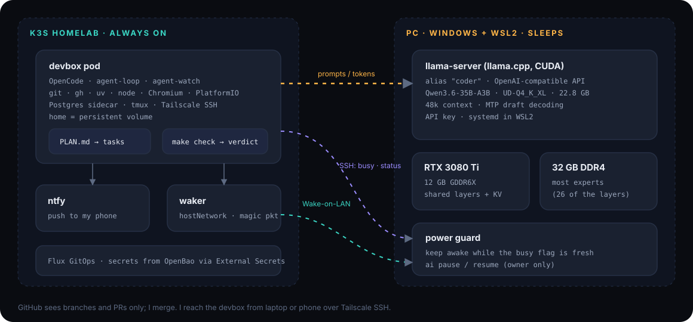

# local-ai-agent

A local LLM on a gaming PC, put to work two ways:

- **an autonomous coding agent**: the model runs on a Windows PC (WSL2 + llama.cpp); the agent runs in an always-on
  devbox pod on the k3s homelab, wakes the PC over Wake-on-LAN when there is work and lets it sleep afterwards. It
  builds features overnight from a plan of small, test-judged tasks;
- **Dewdrop**, a private chat app for family and friends (dewdrop.cedricschippers.dev), with web search, files and
  **Clear Source**, a research profile that answers medical questions only from Dutch guidelines and PubMed and
  checks every quote word for word.

**Status (2026-11-20):** everything runs. Model: Qwen3.6-35B-A3B at ~40 tok/s generation and ~790 tok/s prompt
reading on an RTX 3080 Ti. Dewdrop is live with Clear Source v3; the agent is building file upload and download (loop
D). Details and known issues: [docs/STATUS.md](docs/STATUS.md).

**Documentation:** start at [docs/README.md](docs/README.md): architecture, decisions, Dewdrop, Clear Source,
backend, frontend, the agent loop, the design history, and two presentations
([Dewdrop from hardware to prompt](docs/dewdrop-talk.html), [the local agent setup](docs/local-ai-setup-talk.html):
download and open in a browser; arrow keys, F for fullscreen, P to print).



## Layout

| Path | What | Runs on |
| --- | --- | --- |
| `pc/wsl/` | `.wslconfig`, `wsl.conf` | PC |
| `pc/llama/` | build, bench, systemd unit, server flags | PC (WSL) |
| `pc/power/` | keep-awake, pause/resume, SSH forced command, setup | PC (Windows + WSL) |
| `devbox/` | Container image for the agent pod (toolchains, QA tools, Chromium, `fetch-docs`) | k3s |
| `mac/` | `ai pause\|resume\|status`: control the model from the Mac over `ssh pc` | Mac |
| (homelab repo) `apps/ai-agent/` | Cluster side: namespaces, devbox StatefulSet, waker, NetworkPolicy, ExternalSecrets | k3s (via Flux) |
| `harness/` | `loop.py` and its prompt; project templates | devbox pod |
| `status/` | Status page, job queue, model lease and `/v1` gateway (stdlib Python, `status/SPEC.md`) | k3s |
| `chat/` | Dewdrop, the chat app (FastAPI, `chat/SPEC.md`) with Clear Source | k3s (public via Cloudflare Tunnel) |
| `docs/` | Architecture, decisions, how-tos, design history, presentations | — |

## Rollout

| Phase | Do | Done when | Status |
| --- | --- | --- | --- |
| 1 | `pc/README.md` steps 1–9 | `curl` from a k3s node gets a completion | done |
| 2 | `pc/power/` + waker in the homelab repo, `apps/ai-agent/` | Sleeping PC answers within ~90 s, sleeps again after idle | built; the sleep/wake test through the waker is still to do |
| 3 | Build `devbox/` (CI), devbox in the homelab repo, `apps/ai-agent/` | Phone → Tailscale SSH → tmux → agent edits a toy repo | done (`ssh agent@devbox`) |
| 4 | `harness/loop.py` on a toy spec | 10-task spec runs unattended overnight | done, on the real weather station repo instead of a toy |
| 5 | Weather station repo from `harness/templates/` | Backend + frontend pass tests on agent branches | in progress: website first, gateway/firmware/deploy later |

Values you must fill in are marked `REPLACE_ME` (`grep -rn REPLACE_ME .`).

The Kubernetes manifests live in the homelab repo (github.com/cecedabro/homelab, `apps/ai-agent/`),
deployed by Flux like everything else there; secrets come from OpenBao via External Secrets.
Reason: one GitOps source for the cluster, and this repo (which agents work on) gets no power over
cluster objects such as the privileged waker namespace.

## Day to day

| I want to | Command |
| --- | --- |
| Open the agent | `ssh agent@devbox` (lands in tmux session `agent`; `NO_TMUX=1` skips tmux) |
| Run the loop | in the project repo on the devbox: `agent-loop` (stop after the current task: `touch .agent/STOP`; it stops starting new tasks after 24 h, change with `--max-hours N`). After the tasks it waits for CI and turns failures into fix tasks (`--no-ci` skips) |
| See what the agent is doing | the status page (`status/`, reachable over Tailscale once deployed): model state, the running task, the job queue, all-time commits and lines, token speed, recent events |
| Queue work for the agent | add a job on the status page (unlock it with the status token). `agent-queue` (tmux window `queue` on the devbox, started automatically) runs the jobs one by one, only for repos of `QUEUE_OWNERS`. Pause: `touch ~/.agent-queue-STOP` |
| Chat with the model | Dewdrop (dewdrop.cedricschippers.dev), or the quick chat on the status page. Chat goes before agent work in the gateway's queue |
| Fix failures on main automatically | in a tmux window in the project repo: `agent-watch` (checks every 10 min, one fix PR per failing commit; stop with `touch .agent/WATCH-STOP`) |
| Tell it what to do | edit `PLAN.md` / `SPEC.md` / `AGENTS.md` in the project repo; the agent cannot edit them |
| Free the GPU for myself | on the Mac: `ai pause`; give it back with `ai resume`; `ai status` |
| Watch the GPU | `ssh -t pc "nvidia-smi -l 2"` |
| Read the model log | `ssh pc 'wsl -d Ubuntu -u root -- journalctl -u llama-server -f'` |
| Get offline docs for the agent | on the devbox: `fetch-docs` (into `~/docs`, searched with `rg`) |

Tools available to the agent in the devbox image: git, gh, make, ripgrep, jq, uv, node, platformio,
kubeconform, kustomize, shellcheck, psql, system Chromium (`CHROMIUM_PATH`), bandit, pip-audit,
schemathesis. A Postgres sidecar listens on `localhost:5432` (`DATABASE_URL` is set; data is wiped
on pod restart). No Docker, nothing privileged. Memory is tight: the node has 7.6 GB, so run one
browser and no parallel heavy jobs.

## Safety as built

- Own namespace, no service account token, repo-scoped GitHub token (the agent works on branches and opens PRs; you merge).
- Egress policy: DNS, the public internet on 80/443 (plus Tailscale ports), the PC (8080, 2223) and
  the waker. Private ranges and other pods are blocked. The cluster network cannot filter by
  hostname, so GitHub/PyPI/npm are not singled out. Ingress is closed.
- The devbox key on the PC only runs `ai-power-remote` (busy/status/restart). It cannot pause or
  resume the model: that switch is yours (`ai pause`), and while paused nothing restarts the server.
- Protected paths the agent may not change (checked by the harness): `tests/`, `contract/`,
  `PLAN.md`, `SPEC.md`, `AGENTS.md` (set with `PROTECTED`), plus every path listed in the project's
  committed `.agent-protected` file (which protects itself).
- One run on the model at a time: with `STATUS_URL` set, `agent-loop` takes the status service's
  lease first and waits in line while another run holds it (`--no-status` skips this). If the
  service is down, runs go ahead without it.
- Push failures are loud: an ntfy alert, a `push_failed` event and a "Push failed" section in
  `REPORT.md`; no PR is opened for a branch that didn't push.
- CI feedback: the agent never judges CI itself. The harness reads the GitHub Actions results with
  `gh` (the token needs Actions: read; pushing workflow files needs Workflows: write) and gives a
  failed log to a fresh fix task, at most 3 rounds per run.

## Checks

```
make lint                # shellcheck, python compile, yaml parse
make test                # harness self-test against a throwaway repo with a fake agent
make status-test         # the status service's contract tests
make chat-test           # Dewdrop's tests (K="<pytest -k expr>" for a subset)
make chat-browser-test   # Dewdrop in headless Chromium
```

## Open items

- Sleep/wake test of the PC through the waker (sleep, wake from the devbox, back within ~90 s).
- Occasional slow first request after idle (~13 tok/s prompt reading); unexplained, investigate if it recurs.
- Router DHCP reservation for the PC.
- Netdata in WSL for GPU/CPU graphs (planned, not installed).
- Weather station: gateway, firmware and deploy tasks are not in its `PLAN.md` yet.
